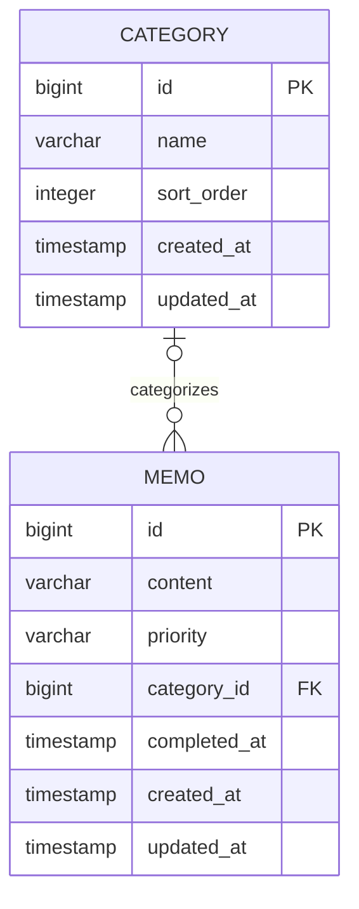

# GIEOKHAM 2 · 기억함

<p align="center">
  
</p>

<p align="center">
  <strong>머릿속은 가볍게, 중요한 일은 또렷하게.</strong><br>
  Keep your thoughts here. Focus on what matters.
</p>

<p align="center">
  
  
  
  
  
</p>

떠오른 생각을 붙잡고, 해야 할 일을 정리하고, 지금 중요한 일에 집중하세요.

**기억함2는 직접 사용해 온 기억함의 경험을 Java · Spring Boot · PostgreSQL로 다시 만드는 프로젝트입니다.**
빠르게 기록하고 편하게 꺼내 보는 사용 경험을 이어 가면서, API부터 데이터 모델과 배포까지 직접 설계하고 구현합니다.

> **현재 단계 · 백엔드 개발 중**  
> 아래 구현 현황은 로컬 개발 및 수동 API 테스트 기준입니다. 문서 작성 시점에는 원격 저장소에서 백엔드 소스가 확인되지 않았습니다. 소스 반영 후 실행 경로와 구현 현황을 함께 갱신할 예정입니다.  
> 기억함2의 웹 화면·로그인·공개 배포는 아직 준비 중입니다.

[기존 기억함 사용하기](https://gieokham.house1583.chatgpt.site) · [1세대 소스 살펴보기](https://github.com/pabu-lim/gieokham)

## 이어 가고 싶은 경험

<table>
  <tr>
    <th width="76%">PC · 중요한 일을 한눈에</th>
    <th width="24%">Mobile · 떠오른 순간 바로</th>
  </tr>
  <tr>
    <td align="center" valign="middle">
      
    </td>
    <td align="center" valign="middle">
      
    </td>
  </tr>
</table>

<sub>위 이미지는 현재 운영 중인 1세대 기억함입니다. 기억함2의 완성 화면이 아닌, 이어 갈 사용자 경험을 보여 주는 참고 이미지입니다.</sub>

## 지금 만들고 있는 핵심

### 생각은 빠르게 남기고, 중요한 일부터

메모를 생성하고 조회·수정·삭제하는 API를 구현했습니다. 중요도는 최상부터 최하까지 5단계로 구분하며, 생성할 때 선택하지 않으면 중간 중요도로 저장합니다.

### 끝낸 일은 정리하고, 필요하면 다시 시작

완료와 완료 취소를 하나의 상태 변경 API로 처리합니다. 완료 일시를 기록하고, 이미 완료된 항목에 같은 요청이 다시 와도 기존 완료 시각을 유지합니다.

### 쌓인 기록 속에서도 필요한 것만

내용 검색, 완료 여부, 중요도를 함께 적용할 수 있습니다. 검색 조건에 맞는 쿼리를 동적으로 구성하고, 페이지 단위로 조회해 기록이 늘어나도 필요한 분량만 가져옵니다.

### 분류는 단순하게, 기록은 안전하게

카테고리 테이블과 메모의 연관관계를 설계했습니다. 카테고리가 없는 메모는 미분류로 다루며, DB 외래키는 카테고리 삭제 시 메모를 보존하고 미분류로 전환하도록 설정했습니다. 카테고리 생성·조회·편집 API는 다음 구현 단계입니다.

## 왜 다시 만드는가

1세대에서는 일상에서 실제로 사용할 수 있는 서비스를 만드는 데 집중했습니다.
기억함2에서는 그 경험을 바탕으로 **서비스의 동작을 직접 이해하고 확장할 수 있는 구조**를 만드는 데 집중합니다.

| 영역 | 1세대 기억함 | 기억함2 |
| --- | --- | --- |
| 데이터 저장 | Firebase Cloud Firestore | PostgreSQL 관계형 모델 |
| 서버 로직 | Firebase 기반 클라이언트 연동 | Spring Boot REST API |
| 데이터 접근 | Firestore SDK | Spring Data JPA |
| 화면 | React 기반 웹앱 | React 화면 구현 예정 |
| 인증 | Firebase Google 로그인 | Spring Security 기반 인증 설계 예정 |
| 배포 | Sites 기반 서비스 | 직접 배포 및 운영 환경 구성 예정 |

기존 서비스와 저장소는 유지합니다. 기억함2는 별도 프로젝트로 개발하며, 기존 데이터의 자동 이전은 아직 구현하지 않았습니다.

## 아키텍처

현재 구현한 백엔드는 요청 처리, 업무 로직, 데이터 접근을 구분합니다.

| 계층 | 역할 |
| --- | --- |
| Controller · 요청 DTO | HTTP 요청 수신, 입력값 검증, 응답 변환 |
| Service | 트랜잭션 경계와 메모 조회·변경 흐름 |
| Entity | 메모 수정, 완료 상태 변경 등 데이터와 변경 규칙 |
| Repository · Specification | 데이터 접근, 선택적 검색 조건 구성 |
| 공통 예외 처리 | 검증 실패·잘못된 요청·없는 메모에 대한 오류 응답 |

- 엔티티를 그대로 노출하지 않고 응답 DTO로 변환합니다.
- 변경 작업은 트랜잭션 안에서 처리하고 JPA 변경 감지를 활용합니다.
- 작성일시는 생성 시 설정하고, 수정일시는 실제 변경 시 갱신합니다.
- 날짜·시간은 현재 한국 시간 기준의 `LocalDateTime`과 `TIMESTAMP`로 다룹니다.
- 스키마는 DBeaver에서 직접 관리하며, `schema.sql`로 초기 구조를 기록합니다. 자동 스키마 변경은 사용하지 않습니다.

### 웹과 모바일을 위한 방향

React 기반 반응형 화면이 같은 REST API를 사용하도록 만들 예정입니다.
운영 초기에는 React 빌드 결과를 Spring Boot에서 함께 제공하는 구성을 목표로 합니다. 개발 중 React 개발 서버를 별도로 실행하더라도, 운영 서버를 반드시 프론트·백엔드로 나눌 필요는 없습니다.

현재는 로컬 개발용 API이며 인증·사용자별 접근 제어는 아직 구현하지 않았습니다. 다중 사용자 공개 운영 전에는 이 부분을 먼저 연결합니다.

## 데이터 모델



- **미분류**: `memo.category_id IS NULL`
- **미완료**: `memo.completed_at IS NULL`
- **완료**: `completed_at`에 완료 일시 저장
- **중요도**: `HIGHEST`, `HIGH`, `MEDIUM`, `LOW`, `LOWEST`
- **카테고리 삭제 정책**: 외래키의 `ON DELETE SET NULL`로 메모 보존
- **무결성**: 공백뿐인 내용·이름과 허용되지 않은 중요도는 DB 제약조건으로도 제한

사용자별 소유 관계, 하위 카테고리, 일정·반복 모델은 이후 확장할 예정입니다.

## API 현황

아래는 로컬에서 구현하고 수동으로 동작을 확인한 메모 API입니다.

| Method | Endpoint | 기능 |
| --- | --- | --- |
| GET | `/api/health` | 애플리케이션 상태 응답 |
| POST | `/api/memos` | 메모 생성 |
| GET | `/api/memos` | 검색·필터·페이지 조회 |
| GET | `/api/memos/{memoId}` | 메모 상세 조회 |
| PATCH | `/api/memos/{memoId}` | 내용·중요도 수정 |
| PATCH | `/api/memos/{memoId}/completion` | 완료·완료 취소 |
| DELETE | `/api/memos/{memoId}` | 메모 삭제 |

`/api/health`는 현재 `UP`을 반환하는 기본 엔드포인트이며, DB 연결까지 검사하는 헬스 체크는 아닙니다.

### 필요한 조건만 조합해서 조회

```http
GET /api/memos?completed=false&priority=HIGH&keyword=공부&page=0&size=20
```

| 파라미터 | 설명 | 생략 시 |
| --- | --- | --- |
| `completed` | 완료 여부 | 완료·미완료 모두 |
| `priority` | 중요도 코드 | 모든 중요도 |
| `keyword` | 내용 포함 검색 | 검색어 제한 없음 |
| `page` | 0부터 시작하는 페이지 번호 | 0 |
| `size` | 페이지 크기, 1~100 | 20 |

최신 작성순으로 정렬하며, 작성일시가 같으면 ID 내림차순으로 정렬합니다.
응답에는 메모 목록과 현재 페이지, 전체 개수, 전체 페이지 수, 다음 페이지 존재 여부를 담습니다.

### 완료 상태 변경

```http
PATCH /api/memos/2/completion
Content-Type: application/json

{
  "completed": true
}
```

`false`를 보내면 완료를 취소합니다. 완료 여부를 생략하거나 `null`로 보내면 검증 오류로 처리합니다.

## 로컬 개발 환경

| 항목 | 설정 |
| --- | --- |
| Java | JDK 17 |
| Spring Boot | 4.1.1 |
| 빌드 | Gradle Wrapper |
| DB | PostgreSQL 17 |
| ORM | Spring Data JPA |
| 편의 도구 | Lombok, Jakarta Validation |
| 개발 도구 | IntelliJ IDEA, DBeaver |

아래 실행 안내는 현재 로컬 개발 구성 기준입니다. 백엔드 소스를 저장소에 반영한 뒤 사용할 수 있습니다.

1. 로컬 PostgreSQL에 `gieokham2` DB와 접속 계정을 준비합니다.
2. 빈 DB에 `database/schema.sql`을 실행합니다. 기존 테이블이 있는 DB에 다시 실행하지 않습니다.
3. 접속 주소를 확인하고 실행 환경에 `DB_PASSWORD`를 설정합니다.
4. IntelliJ에서 `GieokhamApiApplication`을 실행하거나 Gradle Wrapper로 실행합니다.

```properties
spring.application.name=gieokham-api

spring.datasource.url=jdbc:postgresql://127.0.0.1:5433/gieokham2
spring.datasource.username=gieokham_app
spring.datasource.password=${DB_PASSWORD}

spring.jpa.hibernate.ddl-auto=none
spring.jpa.open-in-view=false
```

`5433`은 현재 개발 PC의 PostgreSQL 포트입니다. 본인 환경에 맞게 변경하세요.
실제 비밀번호는 설정 파일이나 Git에 저장하지 않고 실행 환경에서 주입합니다. 애플리케이션 실행 환경의 시간대는 `Asia/Seoul`로 맞춥니다.

Windows PowerShell에서는 백엔드 폴더에서 실행합니다.

```powershell
cd gieokham-api
.\gradlew.bat bootRun
```

`bootRun`은 Spring Boot 앱을 실행하는 Gradle 작업입니다. 기본 API 주소는 `http://localhost:8080`입니다.

## 다음 단계

- [x] 메모 생성·조회·수정·삭제 API
- [x] 완료·완료 취소와 완료 일시 관리
- [x] 내용 검색, 완료·중요도 필터, 페이지 조회
- [x] 요청 검증과 공통 예외 처리
- [x] 카테고리 테이블·엔티티 및 메모 연관관계
- [ ] 카테고리 생성·조회·편집·삭제 API
- [ ] 카테고리별 조회와 메모 이동
- [ ] 사용자 모델과 로그인·접근 제어
- [ ] React 화면과 API 연결
- [ ] 일정·반복, 하위 카테고리, 사용자 지정 정렬
- [ ] 자동화 테스트와 배포 환경 구성
- [ ] 모바일 사용 경험과 PWA 설치

<sub>체크한 항목은 로컬 구현 기준이며, 자동화 테스트 완료나 운영 배포를 의미하지 않습니다.</sub>

---

**기억은 여기에. 집중은 지금에.**

