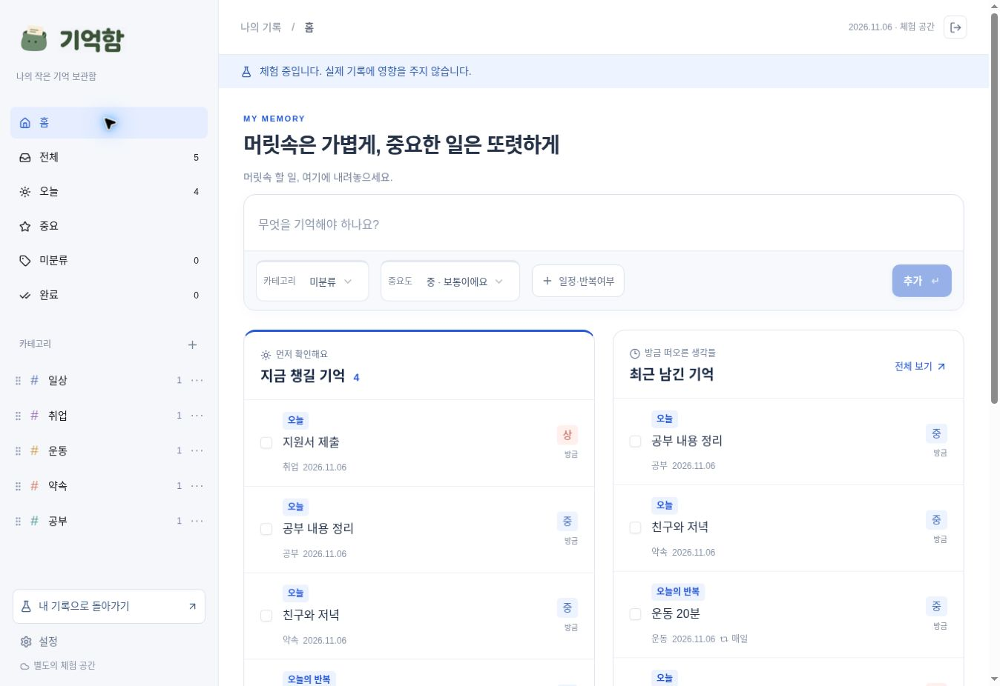
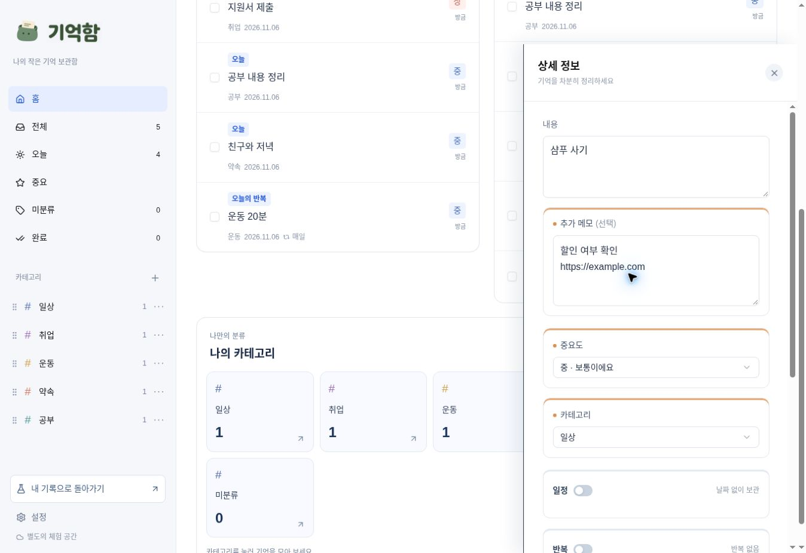

# GIEOKHAM 2 · 기억함

<p align="center">
  
</p>

<p align="center">
  <strong>머릿속은 가볍게, 중요한 일은 또렷하게.</strong><br>
  Keep your thoughts here. Focus on what matters.
</p>

<p align="center">
  
  
  
  
  
</p>

떠오른 생각을 붙잡고, 해야 할 일을 정리하고, 지금 중요한 일에 집중하세요.

**기억함2는 직접 사용해 온 기억함의 경험을 Java · Spring Boot · PostgreSQL로 다시 만드는 프로젝트입니다.**
빠르게 기록하고 편하게 꺼내 보는 사용 경험을 이어 가면서, API부터 데이터 모델과 배포까지 직접 설계하고 구현합니다.

[로컬 실행 방법](#로컬-실행-방법) · [프론트 구현 및 검증](docs/frontend.md) · [기억함1](https://github.com/pabu-lim/gieokham)



## 주요 기능

### 머릿속 생각을 바로 기록

Enter로 빠르게 저장하고 Shift+Enter로 줄을 바꿉니다. 카테고리와 중요도는 입력창에서 함께 선택하고, 카테고리 안에서는 해당 분류가 미리 선택됩니다.

### 지금 챙길 기억을 한눈에

홈에서 임박한 일정·기한이 지난 일·중요한 메모를 먼저 확인하고, 최근 남긴 기억을 함께 봅니다. PC는 두 열, 모바일은 한 열로 보여줍니다.

### 나에게 맞는 정리 방식

5단계 중요도, 하위 카테고리, 검색, 커스텀·중요도·최신순 정렬을 지원합니다. 메모와 카테고리는 드래그로 정리하고, 카테고리를 접거나 펼칠 수 있습니다. 카테고리 삭제 시 하위 카테고리와 메모도 함께 삭제합니다.

### 일정부터 반복 습관까지

시간과 기간은 독립적으로 선택합니다. ‘금요일 14시 병원 예약’처럼 종료일 없는 일정도, 시작·종료 일시가 있는 기간 일정도 기록할 수 있습니다. 일정 없이 반복만 설정할 수도 있습니다. 매일·선택 요일·매월·매년 반복과 날짜별 완료 기록, 완료 취소를 지원합니다.

### 제목은 짧게, 필요한 정보는 상세에

메모의 **추가 메모 (선택)**에 준비물·설명·링크를 최대 10,000자까지 적습니다. 목록에는 첫 줄만 미리 보여주고, 상세를 열면 전체 내용을 편집할 수 있습니다. 저장하지 않고 닫으려 하면 변경 여부를 확인합니다.

<details>
<summary>메모 상세 화면 보기</summary>



</details>

### 내 계정에 안전하게

Google 인증과 명시적인 서비스 가입을 분리합니다. 세션과 CSRF 검증을 사용하고, 서버에서 회원별 소유권을 확인합니다. 로그아웃·세션 만료 시 화면과 암호화 사본을 비웁니다.

## 로컬 실행 방법

Windows PowerShell + IntelliJ 기준입니다. **화면만 체험하려면 1단계와 4단계만** 실행하고 로그인 화면에서 **예시로 체험하기**를 선택하세요. 체험 기록은 서버에 저장되지 않으며 새로고침하면 사라집니다. Google 계정으로 실제 저장하려면 아래 단계를 모두 진행합니다.

### 1. 소스와 도구 준비

전체 실행에는 **JDK 17, Node.js 22.18 이상(npm 포함), PostgreSQL**이 필요합니다. 개발 DB는 PostgreSQL 17을 사용합니다. Gradle은 저장소의 Wrapper를 사용하므로 따로 설치하지 않아도 됩니다.

```powershell
git clone https://github.com/pabu-lim/gieokham2.git
cd gieokham2
```

이미 내려받았다면 저장소에서 `git switch main` 후 `git pull --ff-only`로 최신 코드를 받습니다.

### 2. 개발 전용 DB와 Google 로그인 준비

**주의: `local` 프로필은 Spring을 시작할 때마다 연결된 DB의 기억함 테이블을 삭제하고 테스트 데이터로 다시 채웁니다.** 보관할 기록이 있는 DB를 연결하지 마세요.

- **PostgreSQL:** 기본 연결은 `127.0.0.1:5433/gieokham2`, 계정은 `gieokham_app`입니다. 이미 준비된 DB가 있으면 생성 단계를 건너뜁니다. 새 PC라면 DBeaver에서 관리자 계정으로 `postgres` DB에 연결한 뒤 아래 SQL을 **자동 커밋 상태에서 한 문장씩** 실행합니다. 비밀번호 예시는 자신의 로컬 비밀번호로 바꿉니다.
- **Google:** Google 인증 플랫폼에서 **웹 애플리케이션** OAuth 클라이언트를 준비하고 승인된 리디렉션 URI에 `http://localhost:8080/login/oauth2/code/google`을 등록합니다. 클라이언트 ID와 보안 비밀번호는 다음 단계의 Spring 환경변수로만 전달합니다.

```sql
CREATE ROLE gieokham_app LOGIN PASSWORD '여기에_로컬_DB_비밀번호';
CREATE DATABASE gieokham2 OWNER gieokham_app;
```

### 3. IntelliJ에서 Spring 실행

1. `gieokham-api`를 Gradle 프로젝트로 열고 Project SDK와 Gradle JVM을 **17**로 설정합니다.
2. `GieokhamApiApplication`의 실행 구성(**Run → Edit Configurations**)을 엽니다. **Environment variables**가 보이지 않으면 **Modify options**에서 추가하고 아래 값을 등록합니다. **VM options**에는 `-Duser.timezone=Asia/Seoul`을 넣습니다.

| 환경변수 | 값 |
| --- | --- |
| `SPRING_PROFILES_ACTIVE` | `local` |
| `DB_PASSWORD` | `gieokham_app`의 로컬 비밀번호 |
| `DB_PORT` | 선택. 기본 `5433`; PostgreSQL이 5432에서 실행 중이면 `5432` |
| `GOOGLE_CLIENT_ID`, `GOOGLE_CLIENT_SECRET` | 웹 OAuth 클라이언트의 ID와 보안 비밀번호 (각각 등록) |
| `LOCAL_GOOGLE_SUB_A`, `LOCAL_GOOGLE_SUB_B` | 서로 다른 테스트 계정의 Google OIDC `sub` (이메일이나 OAuth 클라이언트 ID가 아님) |
| `APP_FRONTEND_URL` | 선택. `local` 기본값은 `http://localhost:5173/` |

처음이라 `sub`를 모르면 **개발 DB에서만** A/B에 서로 다른 임시 문자열을 넣어 시작할 수 있습니다. 두 계정으로 차례로 로그인·가입한 뒤 DBeaver에서 `SELECT provider_user_id, member_id FROM member_identity WHERE provider = 'GOOGLE';`로 가입한 계정의 값을 확인합니다. 임시 행을 제외한 실제 값을 A/B에 지정하고 재시작하면 **A는 샘플 메모가 있는 홈**, **B는 빈 홈**으로 바로 들어갑니다. 실행 구성의 실제 비밀번호나 계정 ID는 커밋하지 않습니다.

3. 애플리케이션을 실행합니다. 아래 명령의 응답이 `UP`이면 API가 준비된 상태입니다.

```powershell
(Invoke-RestMethod http://localhost:8080/api/health).status
```

### 4. React 실행 후 접속

저장소 루트에서 **별도 PowerShell**을 열고 실행합니다.

```powershell
cd gieokham-web
npm ci
npm run dev
```

[http://localhost:5173/](http://localhost:5173/)에 접속합니다. **5173은 화면, 8080은 API와 Google 콜백**입니다. 인증을 마치면 다시 5173으로 돌아옵니다. `localhost`와 `127.0.0.1`을 섞어 쓰지 마세요.

`npm ci`는 처음 설치하거나 잠금 파일이 바뀌었을 때 실행합니다. `npm run dev`는 사용하는 동안 켜 두면 화면 수정이 자동 반영됩니다. 종료는 `Ctrl+C`입니다. 로그인 후 8080에 머물면 IntelliJ에서 활성 프로필과 `APP_FRONTEND_URL`을 확인하세요.

## 구성

| 영역 | 기술 및 역할 |
| --- | --- |
| 화면 | React 19 · TypeScript · Vite · 반응형 웹/PWA |
| API | Java 17 · Spring Boot 4.1.1 |
| 인증 | Spring Security · Google OIDC · 서버 세션 |
| 데이터 | PostgreSQL 17 · Spring Data JPA |
| 시작 사본 | IndexedDB · AES-GCM · 추출 불가능한 키 · 24시간 만료 |
| 배포 | React 정적 빌드를 Spring JAR에 포함 가능 |

`gieokham-web`과 `gieokham-api`를 개발 중 별도로 실행합니다. 운영에서는 JAR 하나로 웹·모바일 화면과 API를 제공할 수 있습니다. 상세 명령어와 IntelliJ 환경변수는 [실행 안내](docs/frontend.md)에 있습니다.

## 데이터 구조

| 테이블 | 내용 |
| --- | --- |
| `member` | 회원 이름·닉네임·대표 이메일 |
| `member_identity` | 공급자와 공급자 계정 ID로 회원에 로그인 연결 |
| `category` | 회원별 카테고리·상위 카테고리·순서 |
| `memo` | 내용·추가 메모·중요도·카테고리·일정·반복 규칙·커스텀 순서 |
| `memo_repeat_day` | 매주 반복 요일 |
| `memo_completion` | 반복 메모의 날짜별 완료 기록 |

미분류는 `memo.category_id IS NULL`입니다. 일반 메모 완료는 `completed_at`, 반복 완료는 별도 기록으로 처리합니다. 날짜·시간은 한국 시간 기준이며, 응답 변환은 서비스 트랜잭션 안에서 수행합니다.

스키마는 `gieokham-api/src/main/resources/db/schema.sql`에 있습니다. `local` 프로필은 시작 시 `db/local/reset.sql`로 초기화한 뒤 테스트 데이터를 생성합니다. **실제 기록을 보관할 DB에는 local 프로필을 사용하지 않습니다.**

## API

| 경로 | 기능 |
| --- | --- |
| `/api/auth/me`, `/csrf`, `/signup`, `/logout` | 세션 확인·요청 토큰·가입·로그아웃 |
| `/api/categories` | 카테고리 조회·생성 |
| `/api/categories/{id}`, `/{id}/move` | 수정·하위 포함 삭제·이동 |
| `/api/memos` | 생성·검색·필터·페이지 조회 |
| `/api/memos/{id}` | 상세·수정·삭제 |
| `/api/memos/{id}/completion`, `/{id}/move` | 완료 상태·커스텀 이동 |
| `/api/memos/today`, `/completions/today` | 오늘 할 일·오늘 완료한 반복 메모 |
| `/api/memos/{id}/completions` | 반복 완료 이력 |
| `/api/memos/{id}/completions/{scheduledDate}` | 해당 날짜 완료 취소 |

## 현재 검증과 남은 작업

프론트 테스트와 빌드는 `gieokham-web`에서 `npm test`, `npm run build`로 확인할 수 있습니다. 체험 화면에서는 추가 메모 저장·재조회와 미저장 변경 확인을 검증했습니다. 실제 Google 계정 B의 로컬 로그인은 확인했으며, 추가 메모의 실제 PostgreSQL 저장과 갤럭시 터치·설치는 별도 검증 대상입니다.

보류한 항목은 **통합 완료 목록, 신규 가입 기본 데이터, 백업·불러오기**입니다. 반복 완료 기록은 상세에서 확인합니다. 기억함1 데이터는 자동 이전하지 않습니다.
